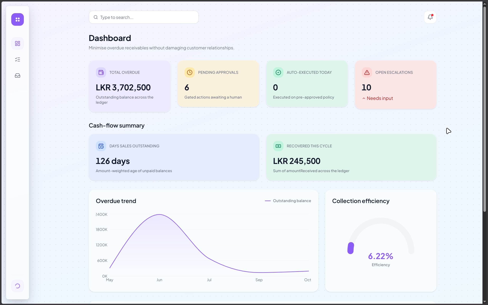
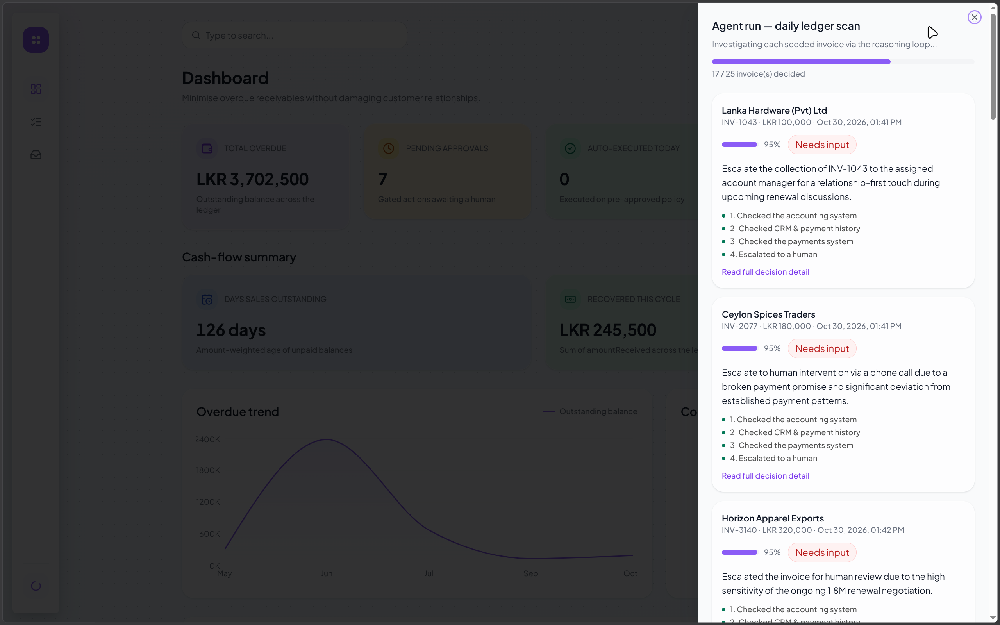
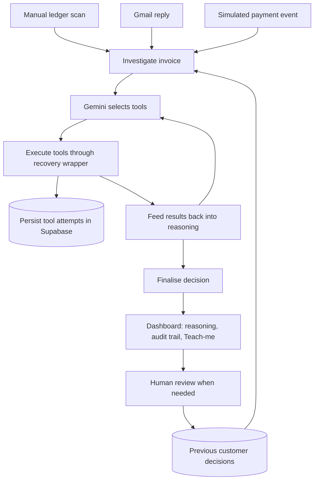

<div align="center">

# InvoiceChaser

**Same lateness. Different decisions.**

An autonomous accounts-receivable agent that investigates invoices, explains its judgment, and brings a human into decisions that need review.

TypeScript · Next.js · Gemini · Supabase · Gmail

[Features](#features) · [How it works](#how-it-works) · [Get started](#get-started) · [Using the app](#using-the-app) · [Commands](#commands) · [Under the hood](#under-the-hood)

</div>



*The dashboard brings outstanding balances, human review, and recent agent activity into one view. Figures shown are from a demo ledger.*

## Why InvoiceChaser?

Two customers with the same overdue balance may need very different responses. One routinely pays late and has a valuable renewal underway. Another has broken a payment promise. A third may already have paid, with a shortfall that needs investigation.

InvoiceChaser works toward one standing goal: **minimise overdue receivables without damaging customer relationships**. It uses customer history, payment evidence, and previous decisions to choose its next action, then makes that reasoning available to the finance officer.

This checkout is a working demonstration with 25 seeded invoices. Gmail and Supabase are live integrations; the remaining business-system adapters use seeded or simulated data.

## Features

### Decisions shaped by customer context

The agent chooses tools through Gemini's native function-calling API. It can investigate relationship value, historical payment timing, broken promises, open deals, disputes, and short payments before choosing an action. Tool selection is not a fixed sequence.



*A scan in progress: the panel shows completed investigations, confidence, tool summaries, and customer-specific recommendations. This capture shows 17 of 25 invoices decided.*

### Human review in the workflow

The approval queue brings together pending approvals and cases needing input. Finance officers can **approve, edit, redirect, or override** a decision, with their action recorded in Supabase and the resolved decision available to later investigations.

The policy asks the agent to seek approval for commercial changes, disputes, escalation beyond a first reminder, and uncertain cases. See [Current scope](#current-scope) for the implementation's enforcement limits.

### An audit trail you can inspect

Tool attempts are persisted as they happen, including failures and recovery attempts. A decision's **Audit trail** tab exposes the inputs, outputs, timestamps, and success status behind the result.

### Learn the judgment, not just the result

The **Teach-me** tab displays a numbered manual procedure: how a finance officer could investigate the same case without the agent, including why each check matters.

### Replies and payment events re-enter reasoning

A Gmail reply can trigger a fresh investigation, with a classification hint of promise, dispute, partial-payment, or query. A payment-event CLI exercises the same core against a simulated incoming payment.

### Recovery that leaves evidence

Tool execution supports retries with backoff, an email-to-SMS fallback, a degraded pending record, and structured human escalation. SMS is simulated in this build; inspect the trail to distinguish a real email from a fallback result.

## How it works



The loop follows **sense → reason → act → observe**. A real terminal tool call—reminder email, reminder SMS, or human escalation—must occur before finalisation. Decision status is derived from the terminal tool and final confidence rather than accepted directly from the model's requested status.

### Integration boundaries

| Category | Current implementation |
| --- | --- |
| Accounting | Invoice and dispute-evidence lookups from seeded data |
| Email | **Live Gmail API** sending and inbox reads using OAuth |
| Payments | Seeded transaction lookup and a simulated payment-event CLI |
| CRM | Seeded relationships, payment patterns, promises, and open deals |
| Calendar + SMS | Simulated follow-up events and SMS results |
| Persistence | **Live Supabase/Postgres** decisions, tool attempts, and human actions |

The adapters expose callable functions behind the tool dispatcher. Connecting a business system requires implementing its adapter; no QuickBooks, Xero, Stripe, HubSpot, Twilio, or Google Calendar connection is included.

## Get started

### Prerequisites

- Node.js **22 or newer** and npm. Node 24 is used in the current local setup.
- A Supabase project.
- A Gemini API key with access to a function-calling model.
- A Google Cloud project with Gmail API enabled and a Gmail account for the demo.
- A browser for the OAuth consent flow and dashboard.

### 1. Clone and install

```bash
git clone https://github.com/invoice-chaser-orbit/Invoice-Chaser.git
cd Invoice-Chaser
npm ci
cp .env.example .env
```

The install lifecycle configures a local Git filter and pre-commit hook that scrub real recipient addresses from staged seed data. Review staged changes before committing.

### 2. Configure Supabase

1. Create a dedicated demo project in [Supabase](https://supabase.com/dashboard), or use your team's existing project.
2. For a **fresh database**, open the SQL Editor and execute [supabase/schema.sql](supabase/schema.sql).
3. Confirm that `decisions`, `trail_steps`, `human_actions`, `invoices`, and the supporting tables exist.
4. Copy the project URL and client API key into the root `.env`:

```dotenv
GEMINI_API_KEY=your-gemini-api-key
NEXT_PUBLIC_SUPABASE_URL=https://your-project.supabase.co
NEXT_PUBLIC_SUPABASE_ANON_KEY=your-supabase-client-key
```

Use an anon/publishable client key for `NEXT_PUBLIC_SUPABASE_ANON_KEY`. The template also contains `SUPABASE_SERVICE_ROLE_KEY` and `GMAIL_USER`; neither is consumed by the current implementation, so they can remain blank. Never put a service-role secret in a `NEXT_PUBLIC_*` variable.

The schema is not an idempotent migration. For an existing database, inspect its tables before applying changes. There is no seed-import command: the dashboard falls back to `data/seed.ts` if the invoice table is empty or its query fails. Decisions and audit trails still require a working database.

The shared client uses the public API role without a user session. Check that your database grants and any RLS policies permit the required operations. The repository does not supply authentication or an RLS policy setup; use a dedicated demo project and configure access control before hosting private data. See [Supabase API keys](https://supabase.com/docs/guides/getting-started/api-keys) and [row-level security](https://supabase.com/docs/guides/database/postgres/row-level-security).

### 3. Configure Gemini

Create an API key in [Google AI Studio](https://aistudio.google.com/) and set `GEMINI_API_KEY` in `.env`.

The model is pinned to `gemini-3.1-flash-lite` in [lib/llm.ts](lib/llm.ts). There is no model environment variable. If your account cannot use that model, verify an available function-calling model before updating the constant. Comments about earlier quotas are historical, not a guarantee of your account's current limits.

### 4. Configure Gmail OAuth

1. Select your project in [Google Cloud Console](https://console.cloud.google.com/).
2. Enable the **Gmail API**.
3. Configure **Google Auth Platform → Branding and Audience**. If the app is in testing, add the Gmail account you will authenticate as a test user.
4. Under **Clients**, create or select an OAuth client of type **Web application**.
5. Add this exact authorised redirect URI:

   ```text
   http://localhost:3000/oauth2callback
   ```

6. Download the client's JSON at creation and save it as `credentials.json` in the repository root. The script expects a top-level `web` object, so Desktop app credentials do not work unchanged.

If you already have a Web application client but lost its secret, add a new secret in that client's settings and save it immediately. Google only makes the full secret available at creation. You can create the required file locally with this structure:

```json
{
  "web": {
    "client_id": "YOUR_CLIENT_ID",
    "client_secret": "YOUR_CLIENT_SECRET",
    "redirect_uris": ["http://localhost:3000/oauth2callback"]
  }
}
```

Keep that callback as the first entry: the helper reads `redirect_uris[0]`. See Google's [OAuth client management](https://support.google.com/cloud/answer/15549257) and [Gmail setup documentation](https://developers.google.com/workspace/gmail/api/quickstart/nodejs).

With **port 3000 free**, run from the project root:

```bash
npx tsx scripts/manual/gmailAuth.ts
```

Sign in and grant the requested Gmail send/read permissions. Successful authentication prints:

```text
Token saved to token.json
```

The authenticated account is the sender; `GMAIL_USER` does not select it. Stop Next.js before running this helper if it occupies port 3000. After authentication, the helper exits and you can start the app.

Both `credentials.json` and `token.json`, along with `.env`, are ignored by Git. Keep them private.

### 5. Set controlled test recipients

Edit only the recipient addresses you need in [data/seed.ts](data/seed.ts), replacing `REPLACE_ME...@example.com` with inboxes you control. Preserve the core scenario data.

**Gmail sends are real.** Normal agent email dispatch rejects placeholder `@example.com` addresses and may fall back to simulated SMS. Human resolution and some manual scripts call Gmail directly, so configure recipients before using them too.

Reply matching uses the sender address and chooses the first matching seed invoice. Use distinct controlled addresses when demonstrating multiple customers.

### 6. Check and start

```bash
npm run typecheck
npm run selfcheck
npm run dev
```

Open **http://localhost:3000** or the address printed by Next.js. Choose **Get started** to enter the dashboard. Restart the server after changing `.env`.

The default selfchecks exercise logic, parsing, and email scrubbing without live Gemini calls. They still load `.env` and import the Supabase client. Live classification checks are opt-in:

```bash
RUN_LIVE_CLASSIFIER_CHECK=1 npm run selfcheck
```

## Using the app

| Route | What you can access |
| --- | --- |
| `/` | Landing page |
| `/how-it-works` | Product workflow explanation |
| `/features/autonomous-reasoning` | Contextual reasoning overview |
| `/features/human-in-the-loop` | Human review overview |
| `/features/audit-trail` | Audit trail and Teach-me overview |
| `/features/tool-integrations` | Tool categories and integrations overview |
| `/overview` | Outstanding balances, review counts, charts, and recent decisions |
| `/decisions` | Status filters, confidence scores, and paginated decisions |
| `/decisions/<id>` | Overview, Audit trail, and Teach-me for one decision |
| `/approvals` | Pending approvals and cases needing human input |

### Run your first investigation

1. Open `/overview` and click the **play-circle icon** at the bottom of the sidebar.
2. Watch the side panel as the scan completes each seeded invoice. A full scan covers **25 invoices** and can take several minutes; reasoning turns and invoices include five-second pauses.
3. Follow **Read full decision detail**, or select a row in `/decisions`.
4. Inspect the reasoning, the **Audit trail**, and the **Teach-me** procedure.
5. For cases needing input, open `/approvals` and review the proposal before choosing an action.

Each scan creates new decisions and can send reminders again. Closing the panel does not cancel execution. Run one scan at a time; there is no global lock or duplicate-send protection.

**Human actions:** approve uses the original action; edit, redirect, and override allow revised action/reasoning and a note. All four currently record the human action, resolve the decision as `auto_executed`, and send the resolved action text by Gmail when an invoice email exists. Redirect and override do not execute separate workflow engines.

### Process a reply

Reply from a configured customer test inbox, then run:

```bash
npm run poll-replies
```

The first poll looks back 24 hours. Later polls use the local `.reply-poll-state.json` cursor. Unknown senders are skipped. Each invocation polls once and exits; it is not a background service. Check `/decisions` for the new reply-triggered decision.

### Exercise a payment event

```bash
npm run webhook -- INV-4002 95500 demo-txn-001
```

This creates a new investigation of the short-payment scenario. It can take actions through the same agent loop. It does not receive a real payment or update ledger balances.

### Demo scenarios

| Invoice | Situation | What to inspect |
| --- | --- | --- |
| `INV-1043` | Loyal payer with a valuable relationship | Payment pattern and relationship-sensitive tone |
| `INV-2077` | A payment promise was broken | How history affects escalation |
| `INV-3140` | An open contract renewal | CRM context changing collection urgency |
| `INV-4002` | LKR 95,500 received against LKR 100,000 | Evidence-based investigation of the LKR 4,500 shortfall |
| `INV-5099` | Ambiguous information | Human escalation instead of an unsupported guess |

The remaining 20 invoices add everyday cases around these five core scenarios. Model output varies; these are intended demonstrations, not fixed expected decisions.

## Commands

| Command | Purpose |
| --- | --- |
| `npm run dev` | Start the Next.js development server |
| `npm run agent` | Run one full seeded-ledger scan |
| `npm run poll-replies` | Poll Gmail once and investigate matched replies |
| `npm run webhook -- <invoiceId> <amountReceived> [transactionId]` | Simulate an incoming payment event |
| `npm run typecheck` | Check backend and application TypeScript |
| `npm run selfcheck` | Run default logic, classifier-parser, and scrubber checks |
| `npm run lint` | Run ESLint |
| `npm run build` | Build Next.js for production |
| `npm start` | Serve the production build |

For recovery demonstrations, these helpers force tool failures and write test records to Supabase:

```bash
npx tsx --env-file=.env scripts/manual/testRecoveryFallback.ts
npx tsx --env-file=.env scripts/manual/testRecoveryEscalate.ts
```

The first demonstrates email retries followed by simulated SMS. The second demonstrates degradation and structured escalation without a fallback. Other manual scripts may send real email; inspect them before running.

## Under the hood

| Layer | Technology |
| --- | --- |
| Web application | Next.js 15 App Router, React 19, TypeScript |
| Interface | Tailwind CSS 4, Radix UI, Motion, Recharts |
| Reasoning | Gemini through `@google/generative-ai` |
| Persistence | Supabase / Postgres |
| Live email | Gmail API through `googleapis` |
| CLI execution | `tsx` |

```text
app/                       Public site, dashboard routes, scan API
components/dashboard/      Overview, approval queue, decision detail, run panel
components/charts/         Ledger charts and collection gauge
components/ui/             Shared interface primitives
agent/
  loop.ts                  Shared reasoning loop and trigger entry points
  tools.ts                 Tool definitions and dispatcher
  prompts.ts               Reasoning policy and confidence threshold
  recovery.ts              Retry, fallback, degradation, escalation
  classifier.ts            Reply classification
  pollReplies.ts           One-shot inbox processing
  paymentWebhook.ts        Simulated payment-event CLI
  memory.ts                Customer outcome memory
lib/
  llm.ts                   Provider boundary; only Gemini SDK import
  decisions.ts             Decision and audit-trail persistence
  invoices.ts              Dashboard invoice retrieval and seed fallback
  executor.ts              Human resolution and email execution
  gmail.ts                 Gmail send and inbox reads
  adapters/                Simulated business-system integrations
  silenceCheck.ts          Unscheduled seven-day silence helper
  types.ts                 Shared domain types
data/                     Seed invoices and customer/payment history
supabase/schema.sql        Database schema
scripts/                   OAuth, manual exercises, Git email scrubbing
```

The model provider is isolated behind `lib/llm.ts`; agent code uses normalised messages, tools, and results. Decisions are written before their trail steps to satisfy database references, then updated with final reasoning. Each tool attempt is persisted during execution.

## Current scope

These details matter when interpreting the demo or extending it:

- **Seeded agent ledger:** dashboard invoices may come from Supabase, but scans, accounting tools, reminder lookup, and reply matching still use `data/seed.ts`. Database-only invoice additions are not scanned.
- **Manual scheduling:** scans and inbox polling run when invoked. Calendar events and SMS are simulated. The seven-day silence helper has no scheduler wired to it.
- **Approval enforcement:** commercial gates are primarily prompt instructions. Open-dispute reminders have an explicit dispatcher guard, but the final confidence threshold is applied after tools execute; a low-confidence result can be marked pending after a reminder has already been sent.
- **Human-action delivery:** the executor saves the human action and resolved status before sending email. A Gmail failure can leave the case resolved without delivery; check errors and Gmail before retrying.
- **Payment reconciliation:** the payment-event command supplies evidence for reasoning, but no live payment gateway, HTTP payment webhook, or balance-update workflow is included.
- **Metric definitions:** “Total overdue” is all outstanding balance; DSO is weighted age of unpaid balances. The trend groups current balances by issue month, and “Recovered this cycle” sums recorded received amounts without a cycle date filter.
- **Demo access:** there is no login, roles, tenant isolation, settings screen, or invoice import/editor. The top search field and notification bell are presentation controls without a search or notification workflow.
- **Recovery scope:** email → simulated SMS is the configured fallback. A degraded pending entry is an audit record, not a durable retry job. Gemini API calls are outside this tool-recovery wrapper.

## Troubleshooting

| Problem | What to check |
| --- | --- |
| `ENOENT ... credentials.json` | Put the OAuth JSON in the repository root and run the helper from that directory |
| `credentials.web` is undefined | Use Web application client credentials with a top-level `web` object |
| OAuth redirect mismatch | Register the exact callback URI and make it the first `redirect_uris` entry |
| Port 3000 already in use during OAuth | Stop Next.js, authenticate, then restart the app |
| Missing Supabase variables | Fill both public Supabase values in root `.env` and restart |
| Missing table or permission error | Check the target project, schema, API grants, and RLS policies |
| No decisions visible | A fresh database is empty until a trigger creates decisions |
| Agent completed but no email arrived | Inspect the trail for placeholder rejection or simulated SMS fallback |
| Model unavailable or quota exceeded | Check model access and quota for your key; review the pinned model in `lib/llm.ts` |
| Reply is skipped | Match the sender to a seed email and check inbox placement and the polling cursor |
| Payment demo did not change dashboard balances | The event handler does not update invoice amounts |
| Build cannot load its font | `next/font/google` fetches Plus Jakarta Sans; check build-time network access |

For the full architecture contract and repository workflow rules, see [CLAUDE.md](CLAUDE.md) and [AGENTS.md](AGENTS.md). Preserve published Git history on the Lovable-connected branch, and coordinate changes to the shared types and core demo scenarios.
